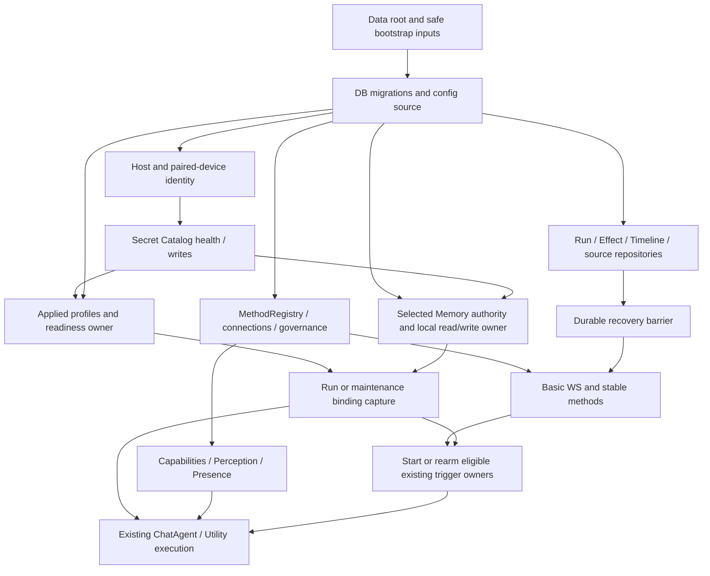

# Research: Core startup dependency map and admission-bound configuration

- Query: Identify the smallest real startup split that serves basic WS APIs without Main/Utility configuration and later enables model work without replacing Memory authority or queue owners.
- Scope: Read-only current Core source; implementation guidance for the authorized task, not an implementation or runtime acceptance result.
- Date: 2026-11-09.
- Baseline: `packages/core/src/main.ts` has 823 lines at this inspection. Existing uncommitted work was preserved. Paths below are relative to `packages/core/src/` unless otherwise qualified.
- Output ownership: Only this research file was written; no production code, profiles, task metadata or processes were changed.

## 1. Actual startup order

The current entry point constructs nearly the entire application before listening. The first missing Main field fails in `bootstrapCore`; partial Utility fails later during Memory construction. There is also a separate readiness delay: starting the scheduler awaits actual due Agent work before WS binds.

| Order / main.ts lines | Construction or start | Actual inputs and consequences |
| --- | --- | --- |
| 181-195 | Lifecycle references and `bootstrapCore(process.env)` | References defer callbacks to owners created later. Bootstrap opens DB/config but also parses model/context/media settings and constructs Main. It is not a storage-only operation. |
| 197-208 | Attribution, cache/maintenance monitor, auxiliary usage | DB-backed read/reconciliation services with demand-time monitor-mode readers. No model needed. Auxiliary interrupted-usage reconciliation is already isolated by catch. |
| 209-217 | Core Host identity, encrypted Secret Catalog | Host UUID and data root bind catalog identity; master-key source comes from process environment. Catalog awaits Wasm loading and may provision a key. No model/network health test. |
| 218-235 | Governance, Run/Event/Effect repositories, Timeline and primary-source repo | Persistent authority and read models. Effect guard closes over the Run repository, not ChatAgent. These can exist without any model. |
| 237-267 | Window calibrator, summary repo, attachment/screenshot stores, ConversationStore | Calibrator and history-budget callback capture boot context. The Store itself is a persistence/projection owner; requiring a live Main model is unnecessary, but model-specific projection policy must move to Run views. |
| 272-274 | Avatar subscriptions/vocabulary/outcomes | Outcome deadline already read at use; no model or renderer required to construct the channel. |
| 277-286 | `composeMemoryRuntime` | Currently requires Main and immediately constructs Utility, authority-selected Memory, maintenance and compaction. This is the largest artificial model/startup coupling. |
| 291-310 | Character store/importer, paired devices, connection registry, Host catalog, MethodRegistry, Approval runtime | Storage/identity/governance dependencies only. Missing avatar assets are not a reason to delay this plane. Device-store corruption remains distinct from first boot. |
| 313-332 | Skill boot, MCP secret migration, MCP owner, methods | Skill reconciliation is awaited. MCP desired/reconcile work has its own generations; the reconcile call at 329 is deliberately detached. Existing missing-Skill behavior differs from unreadable seed-directory errors. |
| 335-347 | Hindsight B3 setup; Memory operation owner and status | B3 has DB/config/catalog dependencies and no boot network calls. Operation service uses live runtime accessors and reconciles foreign in-flight rows at construction. It need not be reconstructed when a model becomes available. |
| 354-381 | Capability broker/tools and unattended route dependencies | Needs connections, Host catalog, governance, Approval and Effects. No model. |
| 388-412 | Perception construction **and start**, browser sources, Presence | `perception.start()` at 399 starts samplers/GC before WS. Browser and Presence owners are model-independent, although later initiative consumers use them. Preserve privacy state independently of Main readiness. |
| 416-443 | Workspace tools and extension composition | Uses authority selection, routes, Skill/MCP catalogs and native image stores. Delayed thunks reference later timezone state; early WS must not expose partially wired closures. |
| 444-459 | RunService and RunSnapshotCapture | Both currently receive frozen Main provider/model metadata; snapshot capture also needs Memory, extensions and governance. RunService construction itself does not call a model. |
| 461-466 | Recovery scan and primary-source reconciliation | A real boot barrier before new trigger admission. Recovery receives **RunRepo**, DB and Effects, not model/RunService. No recovery adapters are passed here, so this composition does not perform remote model replay. |
| 469-509 | Turn queue/registry, schedule definitions, timezone, connect method, patterns/intentions | Stable queue and local services. Definitions/recovery/read APIs do not require Main. Intentions query Memory source state. |
| 511-649 | ChatAgent, chat/read/resource/config/monitor methods | ChatAgent factory only returns a closure; model is consumed later. Config methods are registered at 644, long after the model requirement already blocked bootstrap. |
| 651-725 | Initiative, subagents, Co-Watching/media/viewing, pattern owner | All share existing RunService/ChatAgent/turn controls. Subagents additionally receive Utility for private summaries. Constructors are separate from several start methods; readiness belongs at actual model admission. |
| 726-731 | Scheduled adapter/engine and **await start** | `scheduleEngine.start()` awaits `runDue`, which awaits pending/due occurrence dispatch, Character queue acquisition, Agent streaming and delivery. This can delay WS for a whole task. |
| 734-755 | Attachment GC; optional development capability trigger | GC starts before WS. Dev trigger uses RunService even when its capability operation has no model; admission must distinguish the actual execution requirement. |
| 757-765 | WS bind; Memory and pattern start | Listener finally becomes available. Hindsight Memory start and initiative wake start follow binding. |
| 767-823 | Shutdown function and OS signal handlers | Handlers are installed last; preceding constructor/start failures or a blocked scheduler have no composed shutdown path. |

### Bootstrap detail and true failure boundaries

`boot/core-bootstrap.ts:49` calls `loadServerConfig` just to select the data root, but that loader also validates host/port/log/prompt/trust. At 70 DB opens and migrations run; at 72-74 the config source is composed and resolved; at 77-78 server/context settings parse; at 87-90 Main is constructed; at 102-106 agent/attachment/ambient settings parse. Therefore removing only `loadProviderConfig` does not isolate unrelated invalid setting groups.

`hosts/host-identity.ts:28` preserves an existing malformed identity by refusing it. `devices/paired-device-store.ts:33` similarly distinguishes missing from corrupt security storage. `secrets/secret-catalog-service.ts:75` can await/fail Wasm load, and `:105` can fail key provisioning; missing master-key source otherwise produces a locked service. Those states must remain visible; do not create empty replacement stores to obtain a green startup.

`skills/skill-boot.ts:21` awaits catalog reconciliation; `listLegacyDirectories` at 46 accepts ENOENT but propagates other read errors. Such optional resource work should not prevent basic recovery/configuration APIs from opening. If storage or mandatory authentication identity cannot be used safely, expose the actual failure to the Shell's independent recovery floor, without pretending the Core basic plane is operational.

## 2. Essential dependency graph



The Memory-to-Secret edge is required by selected Hindsight, not a reason to require Main for Local Memory. The existing authority marker decides the provider. An unavailable selected Hindsight connection must not select another authority as a startup fallback.

## 3. Recommended minimal split

Use a few explicit composition responsibilities in the same process. Do not create a service framework or second runtime.

1. **Storage/config bootstrap:** resolve the environment-only data root, open DB/migrations, build application-first source/write services, logger and group readiness. Prepare model profiles as optional capability state, not a required `LanguageModel` return member. Preserve draft/applied revision and environment compatibility rules from `design.md`.
2. **Stable Core owners:** create identities/catalog health, connections/registry, governance/Approval, repositories, history/Character/resource services and the profile owner. Run durable recovery here. Separate local recovery from starting live triggers.
3. **Model-independent feature composition:** create the selected Memory owner, one Utility execution queue, TurnQueue/TurnRegistry, one RunService and one ChatAgent shell. Their factories receive a binding-capture interface, not a fabricated model or a model getter that changes every dispatch. Preserve Memory operation owner, source witnesses, recovery state and queues across profile changes. Start passive non-model capabilities independently where privacy permits.
4. **Stable API publication and listener:** register real API names and typed readiness errors before binding. Construct every dependency reachable from those handlers; do not simply hoist `startWsServer` across `const` declarations and leave handlers touching temporal-dead-zone variables. Model-unavailable is an actionable method result, not METHOD_NOT_FOUND or fake empty data.
5. **Start/rearm trigger owners:** after WS is serving and recovery is complete, start eligible initiative/scheduler/maintenance work. Profile application publishes a new binding revision and notifies the existing owners; it does not rerun the whole bootstrap, re-register every method, or recreate DB/Memory/queues.

`server/ws-server.ts:39` only requires host, port, MethodRegistry, connection registry and logger. Its module has no model dependency. `server/method-registry.ts:66` keeps a live method Map (register currently replaces by name), so staged registration is technically possible. Prefer stable registrations plus explicit readiness: replacing methods alone neither updates existing subscriptions nor gives truthful unavailable states.

### Memory split: what can already be model-independent

- `memory/canonical-local-runtime.ts:35` builds Local authority/repositories/tools/assembly without a LanguageModel. Its model coupling is introduced by `canonical-local-subsystem.ts:24` and `runtime-composition.ts:62` when maintenance and Utility are composed.
- `memory/canonical-local-subsystem.ts:39` initializes existing Character ingestion baselines and starts retention at 42. Keep baseline/source witnessing and non-model retention available independently; do not postpone all Memory bookkeeping until the first successful model reply.
- Legacy engine creation (`memory/bootstrap.ts:141`, `memory/memory-engine.ts:116`) is also model-independent. Eager Utility reads at `bootstrap.ts:96` and `:101` bind flush/episodic model consumers, so those operation factories must capture later.
- Hindsight foreground authority/connection (`memory/hindsight/hindsight-runtime-connection.ts:23`) needs its own configured connection, not Main. Its ingestion wrapper eagerly copies `slot.model` at `hindsight-ingestion-lifetime.ts:29`; remove that constructor-time requirement while retaining cancellation/chain ownership.
- `memory/operations/memory-operation-service.ts:31` already takes `live()` and optional `tidy()` accessors. Keep this single owner and its foreign-row reconciliation at 58. A missing model should refuse model-requiring submissions before dispatch, not return synthetic clean/zero outcomes or advance ingestion checkpoints.
- `memory/runtime-selector.ts:20` is an authority-selection mechanism, not a model-profile switch. Calling it again for every profile apply risks duplicated providers/retention/ingestion and must not be the activation implementation.

## 4. Exact reuse of Run admission capture

### Existing path

`chat.send handler` (`server/methods/chat-send.ts:51`) -> reserve Character lane -> `runs.admit` at 68 -> `RunSnapshotCapture.capture` (`harness/run-service.ts:112`) -> `captureSnapshot` (`harness/run-snapshot-capture.ts:54`) -> Memory/extension capture -> repository admission at `run-service.ts:119` -> ACK -> queued stream -> `runs.context(runId)` at `chat-send.ts:158` -> `ChatAgent.runTurn` -> attempts.

This already provides the right lifetime seam, but **neither `RunExecutionContext` nor `AgentRunContext` currently carries a model/policy binding**. Model remains in `ChatAgentDeps`, and persisted model metadata comes independently from RunService constructor values.

### Concrete target contract

The names below describe a narrow contract; implementation may choose repository-consistent names.

```typescript
// Process-local value; never serialize model objects, callbacks or credentials.
type CapturedModelPolicy = {
  revision: string;
  model: LanguageModel;
  provider: string;
  modelId: string;
  // Bound to this model/profile; policy values do not read a later current profile.
  context: CapturedContextPolicy;
  maxSteps: number;
  release(): void;
};
```

1. At the beginning of `captureSnapshot`, capture the required prepared Main binding **before the first await**. Retain that exact revision while Memory capture may await. No model binding means a typed readiness refusal, not a placeholder model. Release the captured handle if admission later aborts/fails.
2. Return that handle in the process-local execution context and its non-secret revision/provider/model metadata in the persisted snapshot. Derive `RunRepo.admit` provider/model fields from this same captured result; remove the independent constructor-frozen source at `run-service.ts:120`.
3. Extend the common Run/Agent context shape without a second ownership map. Existing terminal cleanup invokes context `dispose` (`harness/run-service.ts:99`, `:189`); compose release with any retained Memory/tool leases. Existing prepared-publication paths must retain their inherited binding semantics rather than recapture a current profile.
4. Resolve the captured execution dependencies once at `runTurn` entry, before attachment/primary-source mutation. Pass that same local dependency value into `executeAttempts` and every `runAttempt`. `agent-attempt.ts:109` may still wrap the bound model for native-input/effect instrumentation; it must not look up `profiles.current()` there or in SDK `prepareStep`.
5. Keep non-profile facts that are intentionally live (current time, privacy retirement, Host/permission currentness, dynamic tool outcomes) separate. Capturing model policy does not freeze withdrawal of consent or permission checks.

For existing tests/direct non-Run callers, retain an explicit injected fixed model/policy compatibility path. Production trigger paths must all use the admission binding: primary, scheduled, subagent, initiative and Co-Watching/media. A development capability-only Run must declare whether it actually needs a model rather than automatically becoming unavailable with empty Main.

### Replay/calibration is part of the same change

`agent-attempt.ts:75` calls `store.project(characterId)` on every attempt. `conversation-store.ts:149` owns that projection and `:202` calls its global `window.budget()`. Changing the global budget after a profile update would make an old Run's overflow retry use a new profile even if its model was correctly captured.

Add an explicit captured projection policy argument or a restricted per-Run projection view over the same ConversationStore/repository. Do not duplicate timeline state. Bind `requestEnvelopeReserve`, `requestReduction`, `requestWindowSnapshot`, `onUsage` and `onOverflow` to the same captured model/context policy (`main.ts:581-599`). A callback may observe evolving calibration for its own retained model binding, but must not resolve a different current binding. Late old-model usage cannot update a newly selected model's calibration or attribution. Detached maintenance gets its own separately captured policy; UI history remains a normal DB read.

## 5. Exact Utility/background capture sites

The current readonly `UtilitySlot.model` appears uniform but consumers read it at different times. Replacing it with a dynamic getter is insufficient and would mix model identity within logical operations.

| Consumer | Current read point | Required refactor boundary |
| --- | --- | --- |
| Utility owner | `memory/utility-slot.ts:44` chooses/wraps Main or explicit Utility at construction | Keep queue/usage owner; expose capture of a prepared selected binding at operation admission. It can exist while no model is available. |
| Legacy flush / episodic | `memory/bootstrap.ts:96`, `:101` copy model into long-lived writers | Capture when the existing flush/episodic logical operation starts, before queue admission; preserve shared flush watermark and writer owner. |
| Canonical ingestion | `canonical-local-ingestion.ts:48` creates a long-lived model adapter; `canonical-ingestion-model.ts:40`, `:57` read slot model inside separate queued gate/extract calls | Capture once for the logical admitted ingestion operation/span work, pass its retained binding through gate/extraction and retained retries. Keep one Character ingestion chain and Utility chain; do not nest the Utility chain around a function that reacquires it. |
| Hindsight ingestion | `hindsight-ingestion-lifetime.ts:29` copies slot model eagerly; same canonical gate adapter | Preserve lifetime/cancellation wrapper while giving the admitted operation its captured handle; constructor must not require Main/Utility readiness. |
| Tidy | `tidy-pass.ts:47` starts operation, `:104` acquires Utility per batch, `:123` reads timeout, `:150` reads model/limits | Capture configuration/model once at operation admission and retain through batches. Keep the existing later DB review/workset capture where required; policy capture and workset capture are not the same event. |
| Compaction | `compaction-coordinator.ts:120` reads model route for durable operation, `:185` reads model again after queue wait/flush | Capture one binding before operation begin; use it for both route metadata and generation. Preserve lease renewal, source digest, summary CAS and retained retry policy. |
| Hindsight curator | `hindsight-policy-curator.ts:48` copies operation config; `hindsight-policy-curator-execution.ts:33` reads slot model per execution | Capture the model with the already operation-scoped policy, not separately for each call. |
| Private child summary | `agents/private-task-summarizer.ts:23-26` reads model inside the Utility queue | Capture at summary-operation admission before queueing; use the same model for effect metadata and correction attempts. Retain the parent Run authority/Attempt checks. |

No Main plus explicit valid Utility must permit eligible independent Utility work. Inherit-Main without Main, explicit disabled, and incomplete explicit Utility are distinct readiness states. Model-unavailable must not be treated as the current `slot.run` generic swallowed failure/undefined success path; do not record fake dispatch usage or mark source coverage complete.

## 6. Trigger and shutdown dependencies

### Scheduled work must not block the control plane

`scheduler/schedule-engine.ts:54` starts by awaiting `runDue`. Its `processTask` at 32 claims/advances the occurrence before adapter dispatch. `scheduled-run-adapter.ts:27-35` admits a Run, waits for the Character lane and streams the complete Agent response. Consequently the current pre-WS await at `main.ts:731` can wait for a model task or busy lane.

Move live start after the basic listener. Add readiness at the real dispatch/claim boundary while keeping the same schedule engine and occurrence outbox. With no Main, preserve definitions and pending occurrences, reconcile already admitted records locally, and avoid repeatedly claiming/failing work or a zero-delay overdue-task spin. Notify/rearm the existing owner on profile readiness changes. On later activation apply existing lateness/missed-occurrence rules; do not replay every historical trigger. Already admitted work retains its binding when Main is subsequently disabled.

Initiative/pattern `start` at `main.ts:765` already follows listening. Add model readiness to eligible admission, not a constructor dependency on a configured model. Perception/browser/Presence are independently useful and keep their own privacy/capability gates. Hindsight sync may be model-independent but still requires its selected connection; do not stop all Memory work solely because Main is absent.

### Current teardown and required staged cleanup

Current `shutdown` begins at `main.ts:768`:

1. Start closing pattern, Co-Watching/media, subagents; close viewing/browser; dispose Perception/Presence; stop scheduler.
2. Seal Run admission, close initiative/recovery, cancel durable work and begin Memory stop.
3. Drain active turns, await feature/scheduler/Memory settlements, await Memory operation settlement, then close WS.
4. Dispose projections/subscriptions, close Skill catalog and MCP manager, then close DB and let Node exit naturally.

Preserve the dependency rule: **stop admissions/producers -> cancel/drain owned work -> finish operation records -> close transports/catalogs -> DB last**. Feature config changes are not shutdown and must not invoke this whole sequence.

Install lifecycle/signal ownership before starting asynchronous producers or accepting WS. Record each constructed close/stop handle, including optional/unavailable features; failed initialization cleans up only completed stages. Existing `startSweeper` returns a stop handle, while attachment/ambient GC wrappers currently discard it; bring those handles under the existing owners so staged failures and updates cannot leak timers. Avoid a new generic dependency-injection framework: explicit composition cleanup with the few real owners is sufficient.

## 7. Recommended implementation checkpoints and experiments

These are preconditions to verify with isolated temporary profiles/mock models first; no experiment was executed by this researcher.

1. **Freeze startup evidence:** instrument/order the current composition and use a temporary profile containing an overdue scheduled task with a deliberately blocked fake stream. Prove config/identity WS readiness previously waits for that stream, then prove the reordered listener serves while the task is blocked.
2. **Base bootstrap split:** empty Main/Utility and partial explicit Utility must reach real authenticated config/profile/history/Character APIs with zero model calls. Verify DB migration/recovery once, preserved existing authority marker, no placeholder keys/models and no implicit profile replacement.
3. **Admission capture:** slow Memory capture after selecting profile A, apply B during that await, and verify A's persisted metadata and dispatch remain coherent. Queue A, apply B, then admit another message in the same timeline: first uses A, new one B. Force overflow retry and verify A's replay budget/calibration/callbacks remain bound to A.
4. **Utility construction/read points:** build Legacy, Canonical and selected-Hindsight owners with Utility unavailable. Verify no eager model read; apply explicit Utility later without replacing owner identity. Hold gate/extract, tidy batches, compaction flush/queue wait and private-summary correction across a profile change; all parts of each admitted operation must use its capture.
5. **No destructive readiness handling:** absent Utility leaves committed primary sources/pending maintenance unconsumed and truthful. Selected-Hindsight connection failure leaves Authority intact and basic setup/status usable; do not fall back to empty Local Memory.
6. **Trigger transitions:** cold no-Main startup must not spin due work, fabricate failed model Runs or mark pending occurrences terminal. Apply Main, confirm existing lateness rules and one execution; disable Main while a Run is active and confirm old completion/new-admission gating.
7. **Partial startup/exit:** inject failures after catalog, Memory, Perception and listener construction; assert owned timers/WS/catalog work settle before DB closes. Repeated apply must not duplicate queues, recovery scans or event subscriptions.
8. **Memory capture regression:** stoplist/index publication must preserve tokenizer/index compatibility for old Run recall/write closures, as required by `design.md` and `implement.md`; model/profile activation cannot bypass authority/lease checks.

After these deterministic and real-WS checks, use the authorized desktop/real-model acceptance path to demonstrate empty startup -> in-app configuration -> reply -> profile change -> subsequent reply without restarting. Record real-model and human acceptance separately.

## Related sources and limits

- Current task `design.md` sections 2, 4 and 5 define basic service/readiness, applied profiles and admission capture; `implement.md` owns the execution sequence.
- `.trellis/spec/backend/{config-store,agent-runtime,canonical-local-memory-runtime,memory-operations,compaction-harness,server-push-and-connection-auth,secret-catalog}.md` provide the existing ownership and failure contracts. Source ordering must change to the accepted application-first rule; existing identity/authority/single-writer boundaries remain.
- All identified bindings/start/stop paths above were read in current source. No claim is made that the proposed split compiles, that every initializer is side-effect-free, or that all failure branches have been exercised.
- This child session has no runtime task pointer; the explicit parent assignment and task.json `in_progress` established the output destination. No task binding was changed.
