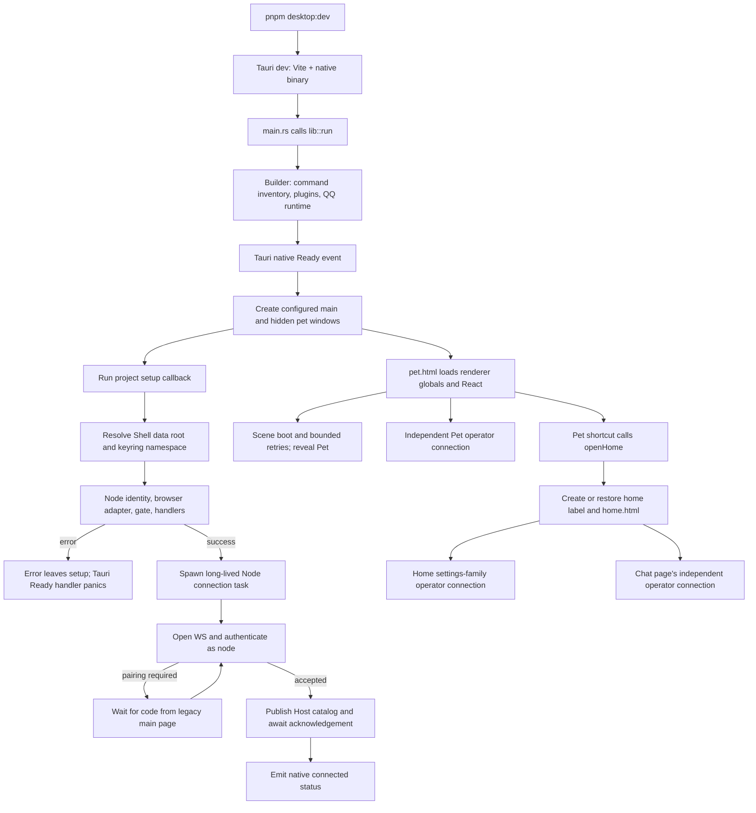

# Desktop startup map and native bootstrap proof

Date: 2026-11-09. S0 investigation for the active flow/configuration task.
Workspace: `H:/TakiAgent-worktrees/t4`; branch:
`task/t4-skills-mcp-productization`; baseline HEAD: `cd3cd91` with existing work.

Production files were read only. Experiments built the existing helper, exercised
only a randomly named **absent** credential account, and ran its existing fake-store
tests. No real application/profile/model was started and no credential was created,
changed, deleted, or printed. Evidence lives in
`artifacts/configuration-runtime-20261109/native-probe/`.

## Scope and controlling contracts

The owner authorized development and asked to understand startup before splitting
implementation. Core and Desktop remain independently startable. This slice does
not introduce an installer, a combined launcher, Core process supervision, or new
remote-device product flows.

Read: `CLAUDE.md`, `CONTEXT.md`, `docs/TECH-STACK.md`, frontend/backend spec indexes,
the cross-layer guide, `frontend/home-window.md`, `frontend/packaged-build.md`,
`frontend/operator-connection-recovery.md`, `backend/secret-catalog.md`,
`backend/server-push-and-connection-auth.md`, and the task PRD/design/plan.

Core remains OS-neutral and the durable storage/device authority. Windows-specific
credential access remains native. Native authentication does not change Core action
governance or Host final enforcement. Home, Chat, and Pet retain independent socket
owners. The previous local-flow research's separate ticket exchange is narrowed
below to a **challenge/proof on the same socket**; no global ticket service is needed.

## Current startup sequence

Important distinction: configuration-created windows are instantiated **before**
the application's setup callback, but a setup error still kills the application
during Ready. Adding Home to `tauri.conf.json` alone does not isolate startup failure.

The installed Tauri 2.11.5 source establishes this exact order:
`src/app.rs:2521` creates configured windows, then invokes `app.setup`;
`src/app.rs:1423` panics on its error before forwarding `RunEvent::Ready`.
The earlier shorthand suggesting `lib.rs`'s `.build().expect(...)` receives the Node
initialization error was imprecise; the relevant failure is the later Ready path.

| Production source | Responsibility and coupling |
| --- | --- |
| `apps/desktop/src-tauri/src/main.rs:4` | Thin native entry; calls `taki_desktop_lib::run()`. |
| `apps/desktop/src-tauri/tauri.conf.json:13` | Creates `main` plus initially hidden `pet`; Home is absent from the configured initial windows. |
| `apps/desktop/src-tauri/src/lib.rs:96` | Setup creates pairing/status state, then calls `build_client(...)?`; no recoverable local initialization state exists. |
| `apps/desktop/src-tauri/src/lib.rs:148` | Resolves Shell profile/keyring, WS endpoint, execution cwd, and native approver. It does not start Core. |
| `apps/desktop/src-tauri/src/node.rs:79` | Directory creation, stable identity read/create, and browser-adapter load can return errors before the WS task starts. |
| `apps/desktop/src-tauri/src/ws_client.rs:57` | Owns native reconnect and browser-listener guard. Status becomes connected only after handshake and Host catalog acknowledgement. |
| `apps/desktop/src/app.tsx:6` | Legacy main page reads native status and forwards console-derived pairing codes. Its read-after-listen status seeding avoids a missed initial event. |
| `apps/desktop/src/lib/open-home-window.ts:28` | Creates a fixed `home` label or shows/focuses the existing one; awaits create/error. Home is normally reached through Pet shortcuts. |
| `apps/desktop/src/windows/home/home-shell.tsx:57` | Navigation is not conditional on Core connectivity. It creates the Home connection and keeps visited pages mounted with visibility qualification. |
| `apps/desktop/src/windows/pet/use-pet-scene.ts:21` | Owns scene create/dispose, three stage attempts, and a 10-second failsafe reveal. A renderer problem does not itself prove Core is unavailable. |
| `apps/desktop/src/windows/pet/pet-stage.tsx:54` | Calls `useCoreConnection(scene)` even while scene is null, provided the React entry loaded. |
| `apps/desktop/src/windows/pet/restore-pet-connection.ts:32` | Can report empty avatar vocabulary for a null scene; then restores avatar/bubble subscriptions. Do not invent an additional model prerequisite for this connection. |
| `apps/desktop/src/windows/pet/use-initial-costume.ts:62` | Imported-costume promotion waits for scene plus an authenticated/restored Pet client; it is a separate readiness stage. |

There are several different Ready states: native event-loop Ready, native Node
authenticated/catalog-published, each operator authenticated/restored, renderer
available, model binding available, and optional integration available. Present
their effect without collapsing all of them into one `connected` boolean.

## Existing lifecycle and cleanup to reuse

- `connection-generation-controller.ts:138` creates a fresh browser transport/client;
  authentication and restoration precede publication. It already owns retirement,
  bounded reconnect timing, late-generation guards, and one stale-token recovery.
  Keep those owners instead of introducing a process-wide browser socket.
- `use-operator-connection.ts:20` hardcodes the default browser endpoint, whereas
  native `lib.rs:169` reads `TAKI_WS_URL`. Endpoint discovery must feed all affected
  owners together. Redirecting only the Node leaves Home/Chat/Pet behind.
- `restore-chat-timeline.ts:31` restores activity and history before Chat is healthy.
  Home's connection can be available independently; its page reads retain existing
  loading/stale/error handling.
- Native `WsClient::run` retains a `BrowserServerGuard`; its Drop closes/aborts the
  adapter task. Socket loss disables browser reporting and starts reconnect.
  The currently discarded JoinHandle offers no explicit local retry/replacement
  owner for failed initial Node assembly; add a small owner for that concern.
- `qqmm.rs:148` closes an obsolete Home's management view carefully, protecting a
  newer window with the same label. `qqmm.rs:175` shuts down the owned QQ helper on
  app Exit, deliberately leaving the external Monitor Host running.
- Pet scene React cleanup disposes the scene; independent operator cleanup closes
  its own socket. Neither should acquire ownership of independently started Core.
- The native get-status snapshot plus event pattern is reusable for startup status;
  initialize the state before windows can invoke it. It currently exposes only
  a coarse string and no structured initialization failure.

## Failure isolation needed before moving the entry window

`BrowserAttachment::load` distinguishes a missing file (already disabled) from
read errors, oversized/bad JSON, invalid ports and invalid/unreadable credentials
(`browser_attachment.rs:66-83`). The latter errors currently escape Node assembly
and kill Ready. Keep the distinction when isolating this optional adapter; do not
silently label corrupted configuration as intentionally disabled.

Put local startup state in native managed state before window creation, then open
the actual `home` label and perform fallible Node/adapter initialization through a
retryable owner. A failed credential/identity load must keep execution unavailable
without replacing the existing identity. A failed optional browser adapter must
leave the rest of the supported Node capabilities and Home reachable where their
own prerequisites permit. Preserve the original configuration bytes.

The new owner needs finite states and causes, not a general workflow framework:
initializing, available, unavailable with a scoped reason, and retry-in-progress.
Retry replaces only the failed component and retires the old task/guard once.
Home cannot diagnose a remote Core DB or provider error from a connection timeout;
show only known local facts when Core is absent.

`ws_client.rs:543` currently maps every non-pairing RPC error to AuthFailed, and
`:161` deletes the cached Node token on AuthFailed. Extend that classification for
local-bootstrap unavailability/protocol/transient errors so a repairable helper
failure does not discard a valid credential. Native handshake reads also need a
bounded setup budget; do not introduce an indefinitely pending local challenge.

The existing `home` window's capability list and native QQ checks refer to its real
label. Keep that label when making it the initial window. Remove the ordinary
local pairing panel, while retaining supported remote/headless explicit pairing
paths through their actual existing handlers and intentional UI routing.

## Helper experiments and actual prerequisites

Environment: Windows; Node `v24.18.0`; Rust `1.97.0`; Cargo `1.97.0`; native MSVC
toolchain; existing dependency caches. These are local cached-build measurements,
not clean-machine timings or release-package acceptance.

| Command / observation | Result | Evidence |
| --- | --- | --- |
| `cargo build --locked --manifest-path apps/desktop/src-tauri/Cargo.toml --bin taki-secret-key --message-format=json` | Exit 0; 18,919 ms wall time; `taki-desktop` rebuilt. | `helper-build-summary.json`, `helper-build.stderr.log`, `helper-build.jsonl` |
| Repeat unchanged helper build | Exit 0; 1,345 ms wall time. | `helper-build-warm-summary.json` |
| `node artifacts/configuration-runtime-20261109/native-probe/helper-read-probe.mjs` | Three unique-account get attempts returned exit 3, zero stdout and the missing-credential diagnostic; 191.451 / 96.501 / 84.892 ms. | `helper-read-summary.json` |
| Existing Core `resolveMasterKeySource(...).read()` against the same absent account | Real helper spawn returned null, as designed; 51.018 ms. | `helper-read-summary.json` |
| `cargo test --locked --manifest-path apps/desktop/src-tauri/Cargo.toml --bin taki-secret-key` | Exit 0; 7 tests passed; 2,007 ms including cached build. Tests use FakeStore, not live Credential Manager. | `helper-tests-summary.json`, `helper-tests.stdout.log` |

The helper executable was obtained from Cargo's `compiler-artifact.executable`,
not guessed from cwd. In this invocation it is
`apps/desktop/src-tauri/target/debug/taki-secret-key.exe`. An absolute executable
path worked from the unrelated probe working directory. Normal startup should
prepare/discover it once and inject its absolute path, accounting for configured
Cargo target directories rather than hardcoding this observed path everywhere.

The helper currently imports `taki_desktop_lib::secrets`, so Cargo still resolves
the full Desktop dependency graph, the QQ external path dependency, build.rs,
generated app command ACLs, and Tauri context macro. That is real build coupling;
successful compilation here does not solve clean-checkout dependency delivery.

The development helper build does **not** call Vite or launch a WebView. Installed
`tauri-macros-2.6.3/src/context.rs:155` selects dev mode without `custom-protocol`;
`tauri-codegen-2.6.3/src/context.rs:178` uses empty embedded assets when devUrl exists.
The non-dev/custom-protocol branch reads and validates frontendDist. This branch
distinction was verified in the applicable source; an absent-dist clean checkout
was not physically constructed. Do not infer production packaging readiness from
this successful development helper build.

The executable's `main` reads stdin to EOF even for `get`. Both the current Core
spawnSync seam and the probe close the input pipe. Runtime preparation must not
inherit an open interactive stdin into a helper read. The probe uses `windowsHide`
and stores only exit/length/boolean diagnostics; Windows background helpers should
not flash console windows.

The first probe script had an incorrect relative source import and failed before
any helper call. The script was corrected inside the owned artifact directory and
the recorded read experiment then passed; this was not a product failure.

## Credential sharing conclusion

The helper uses `KeyringStore::new()` (`taki-secret-key.rs:36`), whose service is
`TakiAgent` (`secrets.rs:22`). The Shell can access that same service/account through
the same native type under the same interactive user. Existing `set_if_absent`
serializes creation with a Windows named mutex and never overwrites a winner.

This proves the relevant source/API wiring and a real missing-account read path.
It does not claim a newly provisioned credential was round-tripped between running
Core and Desktop: no key was created in this investigation. Existing fake-store
tests separately prove framing, create-only behavior and concurrent-winner handling.

Use a dedicated bootstrap account derived internally from the selected Core
profile; do not reuse the model-catalog master key or accept an arbitrary account
from a renderer. Do not assume an isolated Shell's `TakiAgent-<path-hash>` namespace
matches the helper's fixed service. Preserve existing Node/attachment namespaces
and T4-D83 compatibility; connection bootstrap account selection is explicit native
profile composition, not a rewrite of existing credentials.

The measured 51-191 ms spawn/read costs rule out helper calls on each model request
or every browser reconnect. Core and Shell read/cache the bootstrap material once
per active profile initialization; deliberate retry after a known failure may read
again. A new/replaced Core instance can use a new in-memory instance nonce while
retaining the profile credential. No periodic keyring polling is needed.

The catalog-oriented `MasterKeySource.read()` intentionally collapses absent,
unlaunchable, malformed and store-failure cases to null. Reuse its framing and
narrow process adapter, but preserve more diagnostic categories for local startup
where a useful correction action depends on the cause. Never create a replacement
key merely because an unreadable existing key was represented as null.

## Minimal implementation route for native developers

The parent accepted this narrower protocol baseline during S0:

1. Prepare and locate the existing helper in the normal component development
   preparation, without launching the other component. Cache bootstrap material
   in Core/Shell after a successful profile initialization.
2. Extend the existing pre-auth `connect` exchange with a local-challenge phase.
   On that exact accepted socket, Core generates a random nonce and an ephemeral
   server-instance identifier, binds the selected profile and actual endpoint,
   and returns a server proof using standard HMAC. Use Node's standard crypto
   implementation and an appropriate maintained Rust HMAC crate; no custom MAC.
3. Native Node code verifies that challenge against its internally selected
   endpoint/profile and derives its own Node identity/role. For a browser client,
   a narrowly scoped Tauri command verifies the server proof and derives operator
   role plus the actual invoking native window; it returns only the one-use proof
   for this challenge. Native command ACLs must not permit arbitrary role/account/
   file/endpoint selection. Home, Pet and Chat keep their independent sockets.
4. The second `connect` on the **same socket** returns the client proof, bound to
   the challenge, role and device identity. Core consumes that socket's challenge
   once within the existing handshake deadline, authenticates through the existing
   device/role authority, and continues the ordinary Host or operator restoration.
   The socket-local nonce/proof is the short-lived admission ticket; there is no
   global ticket table, separate ticket-issuance service, or cross-socket proof gap.
5. Verify the server before sending any persistent reconnect token. Invalid,
   expired, cross-socket, wrong-profile/role/endpoint proofs fail without rotating
   a stored token. Existing token verification and DeviceRegistry issuance remain
   authoritative; concurrent same-identity windows must not reissue tokens on each
   connection and invalidate each other.

The canonical transcript encoding, purpose separation, and full bound field set
belong in Shared and its Rust mirror, with standard MAC test vectors and wire
fixtures. Server proof and client proof must use distinct purposes. Keep the
challenge bounded by one candidate connection's existing admission lifetime, and
release it with the connection; no background cleanup scheduler is needed.

The old default operator loopback auto-trust **cannot remain an ordinary fallback**:
otherwise an unrelated browser can omit the proof and still obtain full operator
access. Default native use must require the local proof. Retain any deliberately
supported development/headless compatibility behind an explicit configuration
choice and documented scope; do not broaden it to Node. Existing remote explicit
pairing remains separate. Origin checks are useful browser rejection checks but
cannot replace proof of native access.

Current DeviceRegistry exposes find/save-backed issue/verify and pairing; it does
not expose a complete device-revocation product API. Do not build a new revocation
framework for this slice. Preserve existing failed-token and role semantics, and
ensure new auto-enrollment does not overwrite an existing conflicting identity or
silently bypass any deliberate credential refusal being relied upon.

Threat boundary: unrelated browser/loopback clients and wrong/stale local endpoints
must not acquire trusted application identity or receive durable credentials.
Malicious native code already running as the same Windows user with access to that
user's keyring, or an administrator, is not isolated by this mechanism. This is
the project's existing local-user boundary, not a new application attestation system.

## Handoff boundaries and remaining validation

Native implementation owns local startup state, retry/disposal, Home label/window
configuration, native profile/credential selection, helper preparation and native
proof generation. Core/Shared implementation owns challenge state, actual endpoint
binding, typed local-bootstrap outcomes, verification and unchanged device/role
authority. Desktop connection code adapts authenticate/restore while retaining
the existing independent lifecycle owners. Agree these narrow signatures before
concurrent editing.

Still unverified: a provisioned same-user key roundtrip; new challenge/proof wire
behavior; actual app/dev-origin checks; Core-first/Desktop-first application runs;
native Home survival after injected identity/optional-adapter failures; unchanged
permission decisions; and first model activation through Home. These belong to
the S0/S1/S2 acceptance work and are not claimed by helper build/test success.

All credential observations used the random absent account named in
`helper-read-summary.json`. No keyring cleanup was needed because no key was
created. The exact commands, build logs and no-value read observations are retained
in the owned probe directory for the next implementer and independent review.
