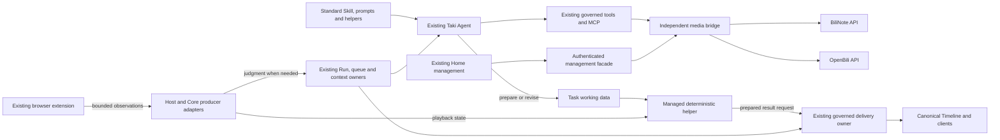

# Media Integration Through Existing Agent Capabilities

Updated: 2026-10-18. Status: the explicit single-video path has a real successful native result, targeted correction and confirmed timed desktop delivery. Independent URL analysis and detected-viewing invitations are integrated; [the entry implementation record](MEDIA-ENTRY-IMPLEMENTATION-2026-10-17.md) records successful fresh URL analysis, a repaired generic background-tool gap and pending screen-dependent invitation acceptance. Temporary validation permissions have been restored. [The earlier invitation record](MEDIA-CO-WATCHING-INVITATION-2026-10-16.md) owns the explicit-chat path. Recommendations, local-file transport, full restart/Continue, human quality and VPS deployment remain incomplete. Historical R5/R6 evidence below is retained for traceability.

The subsequent [2026-10-18 recommendation continuation](MEDIA-RECOMMENDATIONS-IMPLEMENTATION-2026-10-18.md)
implements native OpenBili peek/profile/feedback access and bounded primary-chat pre-analysis without completion
speech, and deploys the native backend through Docker. Real account/profile initialization and recommendation
experience acceptance remain separate from those completed source and deployment gates. The owner released the
screen for another detected-invitation validation; its new temporary settings have their own restoration record.

The later approved testing continuation added a verified total transfer deadline and complete R6 prerequisite/success
gates (19 and 29 local checks). Ordinal 16 ended at 90.015 seconds without a usable response, so R6 correctly refused
before native preparation or execution. These test-infrastructure results do not change the capability/ownership
design or close the live functional prerequisite.

## 1. Authority and purpose

The owner approved targeted V3 validation and native-result/browser/Host interface review without task creation, then authorized the reviewed implementation slices and continued execution. The [2026-10-10 contract report](MEDIA-CONTRACT-REVIEW-2026-10-10.md) preserves the earlier validation-only snapshot. The [implementation and Harness change record](MEDIA-IMPLEMENTATION-2026-10-10.md) owns subsequent source changes, completed checks, current work and real-acceptance limits. Initial delivery/currentness, native result safety, same-ledger quiescent work and trusted prepared-publication composition are implemented. Native structured/provenance generation has completed independent B2 review. B3 local native identity/request reservation, private result integrity and Q&A compatibility have passed independent source/evidence review and disposable-database checks. B4 is now a standalone external MCP package with five native analysis/result tools, installed SDK interoperability and no new Agent/Harness coupling. The [live-validation record](MEDIA-LIVE-VALIDATION-2026-10-13.md) separates its synthetic-producer gates, actual native failure/diagnosis and corrected-code retest. Formal Host/browser data paths, retained-store migration, full Co-Watching and real Heartbeat acceptance remain open.

The earlier isolated validation used an owner-selected Bilibili video and allowed model-testing spend with usage reporting. The [2026-10-09 report](MEDIA-VALIDATION-2026-10-09.md) records that native-service/model/browser evidence and its limits. Later implementation authorization does not make those measurements acceptance of new code, authorize VPS deployment or close real Heartbeat testing. The earlier OpenBili planning binding remains historical; the current continuation follows the owner's no-task choice.

[MEDIA-INTEGRATION.md](MEDIA-INTEGRATION.md) owns product decisions and owner direction M01-M59, including the explicit recommendation-only pre-analysis qualification to M11. This document owns the technical proposal, capability mapping, evidence inventory, validation gates, and proposed delivery slices. The glossary remains in [CONTEXT.md](../CONTEXT.md); existing ADRs and executable specs describe current implementation until an explicitly reviewed amendment is made. M51 settles the accepted-Co-Watching product behavior, not its unimplemented delivery contract.

The governing direction is **map the experience to existing Agent mechanisms first**. Co-Watching is a class of work performed by Taki with a Skill, supporting scripts, task data, browser capabilities, and media services. It is not the basis for another Agent loop, execution queue, conversation store, task scheduler, or publication authority.

The owner reaffirmed this direction on 2026-10-17, specifically including discovery/reuse of existing video analyses.
The integration package must teach the ordinary Agent to use available governed read tools; a Skill is instruction
and resources, not an independent tool registry or service connection. Missing reads should expose the existing
catalog/native owner through the normal tool/MCP facilities, not create another media database or execution system.

The owner reaffirmed this boundary on 2026-10-12: continuation must protect the reusable Agent/Harness rather than
embed the Co-Watching use case in it. Source review found C2's `accepted_co_watching` literal in generic admission;
the follow-up moved M51 classification into the business adapter and made generic prepared publication consume a
separate trusted Class A authorization. Non-media accepted-report tests exercise the same lifecycle without a media
label. This correction does not widen Class B, install a grant endpoint or substitute source tests for real acceptance.

Distinguish three statuses throughout:

- **Confirmed**: owner decisions and currently verified source behavior.
- **Proposed**: the preferred implementation shape below; not an approved production contract.
- **Validation-dependent**: a specific claim that must be proved before its dependent implementation is frozen.

The September [OpenBili PRD](../.trellis/tasks/09-01-openbiliclaw-integration/prd.md) and [design](../.trellis/tasks/09-01-openbiliclaw-integration/design.md) are historical inputs. Their internal-adapter construction, fixed tool list, local-only baseline, and zero-Taki-change assumptions are not this plan.

## 2. Scope and requirement coverage

Deliver three experiences through the same Agent: optional browser Co-Watching; explicit URL/local-video analysis and questions; and OpenBili discovery, profile reference, and recommendation feedback. Bilibili web is the primary end-to-end acceptance path. Other sources require actual acquisition and, for Co-Watching, playback support.

| Confirmed decisions | Implementation obligation | Verification focus |
| --- | --- | --- |
| M01, M06-M07 | Taki owns interaction; a thin bridge reuses running media services and their background work. | No second companion conversation or duplicate backend engine composition. |
| M02-M05 | No topic categorization gate; approximate sampled understanding and optional expression. | Timed text and sampled visual analysis are usable without continuous perception. |
| M08-M09, M24 | Unified service configuration, status, tasks and results; permitted operational assistance. | Ordinary management works without a conversational model call; no new one-click deployment product. |
| M10 | Keep decisions and evidence recoverable. | This proposal, decision record and later execution artifacts agree. |
| M11-M13, M17, M34 | For detected viewing, lightweight judgment and actual media-access evidence precede an invitation; detailed analysis follows acceptance or an explicit request. M53 is the selected-recommendation exception. | Detection alone never starts analysis; defer suppresses another invitation during the same viewing. |
| M14-M16, M18, M35 | Follow actual playback; skip missed timing opportunities; do not replay published commentary; allow optional synthesis/closing reflection. | Pause, seek, rewind, speed, focus/PiP, natural completion and late analysis cases. |
| M19-M21 | Recover credential-dependent work and validate the bound account. | Same-account rotation can recover; another account cannot silently replace or contaminate the binding. |
| M22-M23 | External profile remains source-attributed evidence; stable preference adoption uses existing memory judgment. | No profile mirroring or user-profile-system redesign. |
| M32 | Ordinary like/dislike feedback changes recommendation preferences; platform mutations require explicit platform intent and existing governance. | Keep feedback and actual likes/favorites distinct in tool routing and UI; expose only supported native account actions. |
| M25-M28, M33, M38 | Stop Taki's related preparation/output and insert a cancellation notice; upstream owns jobs/results. | Late results cannot restart output; BiliNote cancellation remains best effort and D86 is not a first-integration prerequisite. |
| M29-M31, M42-M44 | One exact media target and selected playback source; explicit local-file analysis; truthful degradation and accepted understanding limits. | Preserve part/episode identity; no automatic local-player Co-Watching or missing-detail retrieval expansion. |
| M36-M37 | Deliberate Continue after Core restart consumes the reusable D85 recovery contract. | Fresh source/authority validation; no automatic provider replay or resurrection of terminal Runs. |
| M39-M41, M45 | Complete analysis, Skill-guided preparation, editable future content, normal dialogue and coalesced revision. | No model call per playback tick or obligatory whole-plan review after each message. |
| M46-M47 | Bounded recovery, original-job reconciliation, explicit whole-video retry, conversational answers and complete-result access. | No duplicate submissions, hidden re-analysis or automatic duplicate exports. |
| M48-M49 | Use the exact model name `deepseek-flash` for text and vision; prefer Skill composition and existing Agent mechanisms. | Configuration and capability mapping implement these decisions without assuming endpoint image support. |
| M50, M52 | Distinguish deterministic eligibility from Agent judgment and support the three entry paths through common owners. | No extra Co-Watching inference/context from rejected playback ticks; initial effective-playback rule is not a position check or a wait for an unopened recommendation. |
| M51 | Accepted Co-Watching speech is exempt from proactive-utterance allowances for now. | Invitations keep their existing limits; exact consent/scope and publication checks remain, without script-selected class exemptions. |
| M53-M54 | Pre-analyze a bounded Taki-selected recommendation subset independently of later acceptance, then generate commentary only after Co-Watching acceptance. | A declined/direct-viewing recommendation may retain its native analysis but generates no speculative commentary; no full-list automatic analysis or duplicate resubmission. |
| M55-M56 | Offer direct viewing or Co-Watching, immediately open the accepted target, and deduplicate across entry paths. | Direct viewing suppresses another automatic invitation for that viewing; Co-Watching reuses its consent/task; opening, loading and actual playback are separate evidence. |
| M57-M58 | Reuse OpenBili native feedback/scoring and retain its independent recommendation page in Taki. | Page and conversational card share native identity/state; internal selection is not user exposure, and viewing choice is not fabricated content feedback. |
| M59 | Build composable capabilities with adjustable invocation strategy; Schedule-to-Heartbeat is one supported composition. | Reuse analysis/results and runtime contracts across explicit, contextual and scheduled entry; do not require another model handoff for every action or make each strategy change a Core rewrite. |

No TTS engine, continuous audiovisual capture, recent-scene buffer, attention inference, conversation fork, universal workflow engine, or dedicated deployment UI is introduced. Existing TTS contracts remain reserved; text delivery is the baseline.

## 3. Existing foundations and actual gaps

| Capability | Current source evidence | Proposed treatment |
| --- | --- | --- |
| Skill discovery/instructions/resources | [Skill lifecycle](../.trellis/spec/backend/skill-lifecycle.md); [resource reader](../packages/core/src/skills/read-skill-resource-tool.ts). Standard scripts are readable data, not execution grants. | Reuse the existing package format and governance. Do not add a special Co-Watching manifest or auto-execute on Skill load. |
| Task-data reads/writes | [write_file](../packages/core/src/workspace/write-file-tool.ts) and [workspace composition](../packages/core/src/main.ts). Current scratch files are Core-local. | Start with bounded task files and helpers. Do not introduce a candidate database or general artifact platform. Prove filesystem locality before execution. |
| Script execution | [exec tool](../packages/core/src/capabilities/exec-tool.ts), Rust [exec sandbox](../apps/desktop/src-tauri/src/capabilities_impl/exec/sandbox.rs). Synchronous execution; default 30 seconds; no managed background handle surface. | Ordinary helpers reuse exec. Add Host-owned process lifecycle operations only if the selected continuous-work path requires them. |
| Busy-input coordination | [TurnQueue](../packages/core/src/agents/turn-queue.ts), [TurnRegistry](../packages/core/src/agents/turn-registry.ts). Priority and exact cancellation exist; occupied lanes are not preempted automatically. | Extend those owners with a bounded policy for interruptible preparation. Do not create a second queue or promise arbitrary tool suspension. |
| External facts/triggers | [TriggerRequest](../packages/shared/src/harness-schema.ts) already names webhook/provenance/deadline; [Wake contract](../packages/core/src/initiative/wake/wake-contract.ts) has explicit current producers. No generic production script ingress was established. | Add narrow authenticated producer adapters to existing context/trigger paths. A schema enum or glossary Hook is not proof of an implemented entry point. |
| Agent execution | [InitiativeRuntime](../packages/core/src/initiative/initiative-runtime.ts) already admits canonical Runs and calls the same ChatAgent; [ScheduledRunAdapter](../packages/core/src/scheduler/scheduled-run-adapter.ts) also reuses RunService and the Character lane. Scheduled nonempty results may become Class A speech. | Extend shared execution contracts where necessary. Prove non-speaking preparation and governed result consumption; do not infer a missing engine, mandate a second Agent turn, or use Class A scheduled completion to bypass invitation rules. |
| Heartbeat tool scope | [initiative-context](../packages/core/src/agents/initiative-context.ts) intersects a fixed read-tool registry with per-judgment names; [ChatAgent](../packages/core/src/agents/chat-agent.ts) applies it after assembly. [Decision schema](../packages/shared/src/initiative-schema.ts) only exposes silent/express/speak. | Preserve the current executable boundary until reviewed. Compare bounded same-turn actions with a linked ordinary task where independent lifecycle is needed. Loading a Skill grants neither; a generic action handoff is an option, not a mandatory two-stage architecture. |
| Autonomous-work versus notification admission | [Wake budget](../packages/core/src/initiative/wake/wake-budget.ts) checks utterance budget before model admission; [Wake eligibility](../packages/core/src/initiative/wake/wake-eligibility.ts) also checks quiet hours. | Keep this as implementation evidence and verify that accepted Co-Watching follows M51 through the proper task/output path. The owner reaffirmed the existing exemption; R7 is withdrawn. Do not make a general autonomous-work budget redesign a prerequisite or infer changed permissions/quiet-hour rules. |
| Prepared output | [DeliveryCoordinator](../packages/core/src/delivery/delivery-coordinator.ts), [RunDeliveryRepo](../packages/core/src/db/run-delivery-repo.ts), [finishScheduled](../packages/core/src/initiative/initiative-composition.ts). Direct text publication exists internally, with immutable decisions and Run/Attempt requirements. | Expose a governed prepared-result entry using the same ledger/publication owner; the precise admission contract is a validation gate, not an already callable script API. |
| Recovery | [RecoveryCoordinator](../packages/core/src/harness/recovery-coordinator.ts), [RunService](../packages/core/src/harness/run-service.ts), [D85](deferred-decisions.md). Classification exists; executable context is process-local. | Consume D85 for full-restart Continue. Task files do not themselves establish executable recovery. |
| UI and tools | [Home registry](../apps/desktop/src/windows/home/pages.ts), [extension Run assembly](../packages/core/src/extensions/extension-run-context.ts), existing MCP lifecycle. | Reuse navigation, resource states, tool governance and Run inspection; add only service-specific projections and task actions. |

The first two rows are reuse work, not framework feature proposals. The middle rows are candidate improvements with concrete existing owners. A background-process subsystem is not mandatory merely because this use case exists: if browser/service producers and a small managed adapter suffice, use them.

## 4. Proposed composition

The graph is a responsibility map, not a claim that its new adapters already exist. Core continues to own global policy and canonical Run/Effect/Timeline evidence. OS effects and interpreter processes execute on the explicitly selected Execution Host. A helper never receives an operator-wide token or writes Timeline rows directly.

### 4.1 Skill and task data

Use a normal Skill containing `SKILL.md`, prompt/reference files, deterministic helper scripts and optional initial-data templates. The Skill describes acquisition tool use, evidence limits, Character expression, spoiler restraint, plan revision and cleanup. It does not install itself as a permanent background service or acquire permissions by being enabled.

Proposed per-task working data includes the exact media/part identity, selected observation source, upstream job/result reference, active Skill revision, analysis basis, a bounded candidate list, plan revision and pending edit scope. Each candidate has stable identity, text, media-time eligibility and source references. These are task contents, not new global glossary entities or framework-owned video fields.

The Agent may write a proposed edit with existing file tools. A single helper validates and commits the working snapshot using bounded, serialized updates; invalid or stale edits leave affected output withheld. The current `write_file` call is not an atomic compare-and-swap operation, so the exact update/rename mechanism must be verified in the target filesystem. No distributed merge protocol is needed.

Publication evidence comes from the existing ledger, not a model-editable `delivered: true` flag. Task data cannot grant authority, change a Run's captured policy, reopen a stopped task, or manufacture a fresh consent source. Actual task closure, execution handles and publication eligibility must remain bound to framework-owned identities.

Temporary expression changes modify task contents. Durable preferences follow existing memory judgment. Changing a published Skill uses the existing immutable Skill lifecycle and any applicable Learning Proposal approval; M45 does not authorize in-place self-modification of published packages.

#### Existing-analysis discovery and reuse

Current Core invitation code already matches exact BV/CID/page and selected service against its analysis catalog,
then reuses a verified result or reconciles the retained native request. Only explicit confirmed-failure `reanalyze`
replaces that request. Duplicate prevention is enforced by these owners even when the Agent omits a discovery read.

The 2026-10-17 implementation adds `manage_co_watching(list_analyses)` over the existing registered Core catalog. The
tool belongs to the `taki-co-watching` package integration and reaches the model only after its current-generation
full Skill load. The generic `ChatAgentDeps.skillTools` hook and SDK `prepareStep`/`activeTools` select registered,
governed tools; they do not create a new registry, Skill manifest, Agent loop or connection. Exact MCP tools are
separately disclosed through the existing discover/describe flow. See [the disclosure contract](../.trellis/spec/backend/tool-disclosure.md).

Inventory scope is explicitly `core_registered_analyses`, not every historical BiliNote job or proof of current upstream
completion/availability. Operator registration can precede native verification; consumption retains that check. Listing neither accepts
Co-Watching nor submits/reconciles native work or reads full video content. Existing matching/reuse stays with its
original owners. The Skill bundles query guidance in `references/tools.md` using ordinary resource loading. No native
credentials or rejected results enter this inventory. The [delivery record](SKILL-TOOL-DISCLOSURE-2026-10-17.md)
separates automated request-body checks, the new live query, and earlier live video reuse; these do not constitute
complete M49 architectural acceptance of every existing Co-Watching business boundary.

The follow-on ordinary-result read adds `read_analysis` to the same Skill tool. It uses the existing registered reference,
captured extension search/call and native verifier to read analysis or complete original JSON pages without accepting
Co-Watching, submitting native work or generating task data. See [the read delivery record](MEDIA-ANALYSIS-READ-2026-10-17.md).
Tool-choice reliability under ordinary phrasing is tracked as prompt/model-use tuning and does not block this functional
continuation, following the owner's 2026-10-17 direction.

### 4.2 Host and filesystem locality

Prefer the existing paired desktop Execution Host for browser attachment and lightweight helpers; heavy analysis and recommendation work stay in the media services, supporting the owner's VPS offload goal.

The current Core Workspace and Host exec filesystem are not interchangeable. The Shell currently advertises no concrete Workspace inventory. The initial same-machine probe must show the actual script/data path and interpreter on the selected Host. For a split deployment, use governed Host-local file/staging capabilities or a deliberately selected co-located Execution Host. Do not pass a Core absolute path to another machine or silently fall back to a different Host. See [ADR 0007](adr/0007-capability-data-locality-split-machine.md).

If Host-local staging/read/write is missing, record that precise reusable capability gap. Do not solve it by spawning a script from Core, copying private files through model text, or treating arbitrary transfer as credential export. Model credentials stay with their owning provider/service.

### 4.3 Continuous work and Agent input

Prefer event-driven state replacement to a timer that wakes the model. Media ticks update the selected observation and drive a deterministic helper. M50 gates detected viewing before additional judgment/context preparation. An analysis completion or needed revision can request a normal bounded Agent execution. Invitations continue through the existing initiative judgment path; M53 additionally permits separate, governed selected-recommendation preparation before invitation acceptance. Commentary still waits for Co-Watching acceptance under M54.

The current selected-context judgment advertises only time, Memory and Skill resource reads plus `heartbeat_respond`; its execution wrapper enforces expiry and ordinary governance. Ordinary relationship replay is empty. Adding an MCP name to the per-judgment list or to a Skill does not bypass the fixed registry, and its three decision outcomes do not dispatch background jobs. This is a current implementation boundary, not a limitation of the overall Agent framework.

One supported default for daily preparation is an existing Scheduled Task/ordinary Agent Run that reads native recommendation material, selects a bounded subset and requests native analysis through normal governed tools. M59 requires the same capabilities to remain usable from an explicit request or an eligible contextual decision. Results stay task/service data; a later eligible initiative opportunity may consume a bounded projection. The current scheduled adapter can automatically publish Class A final text, so non-speaking completion and result consumption must be proved in V3/V6. Exact dispatch interfaces remain proposed; a timer cannot bypass invitation limits or cause inference for every pool update.

The 2026-10-09 correction is that initiative already enters the ordinary Run/ChatAgent engine. The proposed extension concerns what an autonomous turn may do, its admitted work scope and how its results are surfaced. Consider bounded same-turn tools and linked tasks according to lifecycle needs; do not hard-code a mandatory judgment-Agent-to-worker-Agent chain. Existing Companion Initiative and Autonomous Run glossary terms suffice. External references support this distinction but do not authorize removing tool governance.

The earlier completion audit identifies result-consumption seams:

| Existing seam | Verified scope | Design implication |
| --- | --- | --- |
| [Completion source](../packages/core/src/db/initiative-completion-source.ts) | Reads recent canonical completed scheduled/subagent/webhook Runs and marks existing Class A delivery. Its rows carry identity/time, not an analysis body. | Reuse canonical completion evidence; Core submission completion alone does not establish native BiliNote analysis/result readiness. |
| [Committed-event bridge](../packages/core/src/initiative/pattern-composition.ts) | `run.settled` on those background initiators notifies the existing WakeEngine. | No new event bus or model loop is required merely to signal a completion. The signal still needs an eligible accepted purpose and source. |
| [Completion matcher](../packages/core/src/initiative/wake/wake-matcher.ts) | `completion_of` names a specific Run, excludes already Class A-delivered work, and accepts completion freshness for only 60 seconds. The source query's 24-hour history window does not extend this eligibility. | It is not a ready-made all-day recommendation queue or recurring batch subscription. Do not renew old completion timestamps or create fake Runs/Patterns to force another opportunity. |
| [Context builder](../packages/core/src/initiative/initiative-context-builder.ts) | Assembles selected purposes, Persona/Memory and optional observations, with source references; it does not load arbitrary completed task results. Its current allowed names are time/Skill reads plus conditional recall, narrower than the maximum fixed read registry. | A bounded prepared-result projection with exact origin/revision/readiness is a real integration gap; a completion label alone cannot give Taki the video analysis. Do not paste result text into trusted instructions. |

Preferred next design is a non-speaking preparation result plus a source adapter that can validate still-available prepared material when an existing initiative opportunity is considered. Retain the real completion time and upstream job/result identity. Separate preparation readiness, invitation eligibility, actual invitation publication and Co-Watching consent. Choosing direct viewing, accepting Co-Watching or withdrawing the source changes eligibility without rewriting content scores. Whether an initially inconvenient recommendation remains eligible at later ordinary opportunities is the next behavioral question; its exact window is not frozen, and there is no mandatory catch-up notification.

Where a helper must outlive one synchronous tool call, the preferred enhancement is a Host-owned managed process handle with bounded output, status and stop operations. Keep its command, Host, originating Run/Attempt, policy and connection generation explicit. Waiting for the handle and stopping the process are different operations. An accepted cancel request is not proof of process-tree or remote-provider termination.

The exact relationship between a still-running process Effect, a waiting Run and later result-delivery executions must be demonstrated before changing lifecycle schemas. Prefer the existing nonterminal wait/continuation semantics where applicable. If a completed preparation Run is followed by a separate delivery execution, retain explicit source/parent linkage and fresh admission; never revive its terminal Attempt. An interrupted nonterminal Run follows the existing resume identity rules. Do not introduce a separate activity ledger to avoid resolving this contract.

For foreground input, initially use the existing primary reservation plus targeted cooperative cancellation of eligible speculative preparation. Preserve completed task data and let the normal user turn proceed. Do not automatically cancel unrelated or externally effectful work. Add same-turn steering only if the installed SDK and existing tool-evidence rules support it and it is needed; reproducing every OpenClaw queue mode is not a prerequisite.

After dialogue, no requested edit means the valid plan can remain. Required edits are coalesced and withhold affected output until settled; unknown impact withholds timed output. Releasing a hold always uses current playback and current framework bindings, not an old publication callback made to appear fresh.

### 4.4 Prepared content and publication policy — review point R1

Distinguish:

| Output | Proposed existing concept | Required boundary |
| --- | --- | --- |
| An unsolicited invitation or recommendation | Existing Class B initiative | Preserve eligibility, quiet/freshness checks and its configured accounting. |
| A task status/completion artifact with no Character speech | Existing Run Receipt/status projection | Do not turn it into an ordinary assistant utterance or pollute replay. |
| Character speech while carrying out accepted Co-Watching | M51 confirms exemption from proactive-utterance allowances; a shared accepted-task output path using Class A semantics remains the implementation proposal | Core must retain and validate the original user instruction/acceptance, bounded task scope and current policy; a script cannot choose the class itself. |

R1's **Co-Watching product decision is settled**: accepted-task speech does not consume or wait on proactive-utterance allowances for now; adding such limits is a future reconsideration. Unsolicited recommendations/invitations retain their current rules. Stop, foreground coordination, task scope, playback timing and publication integrity still apply. The exact Class A/admission mapping remains a reviewed implementation obligation; this does not exempt unrelated autonomous work, background model usage or every kind of accepted task. Core must derive the distinction from real origin and scope rather than a model-supplied label.

The prepared-result entry must freeze the exact selected text/revision, bind publication to a valid admitted Run and its active Attempt, recheck cancellation and currentness at canonical commitment, and use the existing atomic Timeline/publication owner. Source linkage is additional evidence, never a substitute for those Run/Attempt checks. If the preparation Run has finished, Core must admit the later publication execution and retain explicit source/parent linkage; it must not reopen the completed Run or let a script invent a running identity. A helper proposes content; it cannot assert that the content was sent. Transport unknown remains unknown and must not trigger automatic duplicate replay. Actual Character utterances join ordinary history; task working material does not become speech merely because it was generated. See [ADR 0010](adr/0010-separate-autonomous-run-history-from-relationship-timeline.md) and [initiative delivery spec](../.trellis/spec/backend/initiative-runtime.md).

Current delivery is unique per Run and its decision is immutable. Two different prepared utterances therefore cannot overwrite or reuse one delivery decision; they require distinct admitted delivery executions under the reviewed composition. Retrying the same publication retains its identity. V3 must prove both cases, including that admission alone does not fabricate a model Effect or inflate model-call counts.

Skill code owns media-time selection and content restraint. The framework owns cancellation, policy, source validity and publication integrity. A source-validity adapter may supply the selected media/plan check; this does not justify teaching the generic queue about Bilibili IDs. Optional Avatar actions use existing governed presentation outcomes and current vocabulary. TTS is not assumed.

## 5. Browser and media-service adapters

### 5.1 Browser observation

Prefer a small optional Taki attachment module in the existing OpenBili extension. Reuse its platform adapters and video listeners. Evaluate BiliNote's existing subtitle acquisition as reusable upstream functionality; do not merge two entire extension frontends or copy reference-project implementations into Taki.

Keep behavior-history upload separate from live playback observation. OpenBili's existing 30-second batch path is not the Co-Watching clock. A bounded observation snapshot needs selected tab/document/player correlation, source generation and sequence, observation time, exact media/part identity, position, play/pause/buffering/end state, rate and visibility/PiP facts. Determine cadence and freshness from browser measurements, with finite stale-state handling.

A page change, another tab or the same BV with another part cannot take over implicitly. Disconnection suspends dependent output; reconnect obtains a current snapshot rather than replaying old ticks. Browser observation does not establish successful backend acquisition or complete understanding.

Prefer attachment through the paired desktop Host and a narrowly scoped browser channel. The current `operator`/`node` handshake does not itself supply this adapter; do not assign browser collectors operator privileges. Reuse existing privacy/source controls. The adapter design must preserve exact Host/source ownership and must not treat webpage content as trusted instructions.

### 5.2 Independent bridge

Propose one independent bridge package with two separately configured native HTTP clients: BiliNote and OpenBili. A single process is sufficient initially; one backend's outage must not remove the other backend's usable operations. Keep namespaces, credentials, readiness and source identity separate.

Use the existing Python MCP SDK after selecting and locking a compatible version during authorized setup. Reuse Taki's current MCP transport, discovery, snapshots and governance. Do not import OpenBili's internal engine bundle into the bridge or depend on its database. Prefer ordinary REST; the existing `/api/agent-bridge` has a separate cached adapter and is not a proven hot-config-consistent substitute.

The initial logical Agent surface is analysis submit/status/result, media-access inspection where a real native check exists, recommendations, source-attributed profile reads, and recommendation feedback. Exact names and schemas are finalized from native operations, not the historical fixed thirteen-tool list. Platform account actions remain separately classified and appear only for actually supported native operations. Operator configuration and task management are separate authenticated routes, delegating to the same service clients rather than becoming model administration tools.

Submitted analysis returns its native job identity. Observe that job with one bounded polling/event owner and emit a completion fact; no model polling loop is necessary. Correlate service instance, original request and job identity. A timeout cannot authorize resubmission, and a status read must never start work. Full results remain upstream-owned; a short tool projection or chat answer is not the entire analysis artifact.

### 5.3 Upstream changes to validate and scope

| Backend | Required behavior | Preferred bounded change |
| --- | --- | --- |
| BiliNote | Structured approximately timed analysis with actual evidence basis | Add an opt-in validated output mode at the existing analysis/merge stage. Keep the ordinary Markdown path compatible; avoid another model pass merely to parse Markdown. Preserve numeric times, exact media identity and actual visual/text use. |
| BiliNote | Reliable submit/status/result semantics | Add native idempotent request handling and distinguish absent, running, failed and unavailable results. Correct success/result ordering; expose native job inventory for management. Do not build a second job database in Taki or the bridge. |
| BiliNote | Consistent selected media and usable credentials | Fix the validated part/CID/cache/subtitle mismatch paths and verify downloader credential reload. Reuse native downloader/transcriber components. |
| BiliNote | Concurrent analysis correctness | Investigate shared frame/grid directories under the selected concurrency. If confirmed, isolate them per job in the existing pipeline; do not claim the static risk was reproduced. |
| BiliNote | Protected remote access and safe management projection | Use protected ingress and explicit safe fields. Raw provider/Cookie responses cannot be forwarded to the UI/model. Validate upload names, size and transfer ownership before enabling local-file upload. |
| OpenBili | Existing account binding survives browser account change | Validate account identity at native credential-write and behavior-ingestion boundaries; same-account updates remain automatic. An MCP-only check would leave direct extension writes unprotected. |
| OpenBili | Provenance, readiness and native configuration application | Preserve source/account attribution and save/apply revisions; inspect actual readiness instead of HTTP 200 alone. Only patch missing fields or seams. |

The per-media access inspection must use the acquisition primitives for the requested mode. Title, pool size, account health and provider ping are insufficient. Detected viewing does not run detailed analysis before acceptance; M53 expressly allows it for the separately selected recommendation batch. A preflight reports what was actually checked and remains a point-in-time result, not a guarantee against later network failure.

D86 isolated BiliNote cancellation stays low priority and outside the first-integration prerequisites. Use a native per-job stop if available; otherwise permit completion while Taki stops its own work. Do not terminate shared services as a substitute.

### 5.4 Models and deployment

Use the exact `model = deepseek-flash` for text and visual calls. During authorized setup, reuse the endpoint and credential source from `H:/TakiAgent/.env.local`, map them into each service's native configuration, and do not copy its existing model selections blindly. No secrets belong in this document or Skill files.

Validate both text and image input against the actual endpoint, including the installed SDK's schema/request representation. ASR and embedding are separate requirements: retain configurable native Whisper/ASR and embedding paths; `deepseek-flash` alone is not evidence that either is supplied. Choose from already supported options after checking the deployment environment.

First run isolated local verification from the supplied source trees; then verify the intended VPS/network topology and browser attachment. Local success does not establish overseas acquisition, remote authentication or cross-Host script locality. Establish a traceable upstream source baseline before editing the ZIP-only OpenBili checkout. Later upstream code changes use that project's required worktree discipline.

### 5.5 OpenBili browsing and native feedback

M08/M57/M58 retain an OpenBili page inside the existing Home registry, independently of conversational Co-Watching. The preferred lightweight scope is its normal recommendation list, native reasons/details, content opening, native feedback and necessary management links. Preserve upstream source identities, ranking/learning and existing operation semantics; do not require Taki's model to approve every card the user browses. Exact component reuse/adaptation versus embedding remains an implementation choice to assess, not a frozen design.

Conversational recommendations show a small selected subset with direct-viewing/Co-Watching choices and a route to details. Native feedback may live in the full page or secondary card actions; two primary buttons and exact labels are UI proposals. Opening content through either surface uses the corresponding supported upstream click semantics. Selecting Co-Watching is not automatically a like, and selecting direct viewing is not a dislike. The native API accepts `like/dislike/comment/dismiss`; their weights and learning effects remain OpenBili-owned.

An internal candidate request can consume upstream recommendation state: the inspected recommendation GET may top up with `serve()` and mark pool items shown. Review native peek/serve/present/click meanings before wiring background selection and user browsing. Preserve stable identity and idempotent feedback, with no synthetic user exposure, second scoring model or parallel recommendation history. Browser task controls remain distinct from content feedback even when they share a card.

## 6. Concrete experience through this composition

### 6.1 Entry-specific preparation

| Entry | Deterministic/Agent sequence | Analysis and consent |
| --- | --- | --- |
| Detected viewing | Bind exact media/player; check effective playback, remaining time, source freshness, cross-entry suppression and existing initiative gates; then prepare bounded context and let Taki judge. | The default effective-playback threshold is 60 seconds, measured from eligible observations rather than `currentTime >= 60`. Detailed analysis follows Co-Watching acceptance or an explicit analysis request. |
| Explicit user request | Resolve the requested media and actual capability through the ordinary Agent path. No unsolicited-invitation dwell is required. | A request to watch together supplies consent. A request only for analysis/Q&A follows M47 without starting Co-Watching. |
| OpenBili recommendation | The intended daily preparation reads existing native recommendation material, lets Taki select one/few videos, and submits native BiliNote analysis. An eligible initiative opportunity can later present the prepared recommendation. | Selected pre-analysis runs independently of later viewing choice. Commentary waits for Co-Watching acceptance. An unopened recommendation has no prior-playback dwell requirement. |

Detected-viewing gates must precede extra Co-Watching model work. Rejected ticks/candidates remain bounded observation/policy data, not appended conversational messages. Seeks do not add effective viewing, speed does not multiply real elapsed time, pause/buffering/absence add none, and media changes reset the source. Use existing source claims/cooldown/budgets to prevent repeated inference, rechecking currentness before dispatch, invitation publication and acceptance. The approved defaults require 60 seconds of effective viewing and at least 120 seconds remaining, expire an invitation after 120 seconds, and suppress automatic invitations when duration is unknown. The three numerical settings are live configurable; [the entry implementation record](MEDIA-ENTRY-IMPLEMENTATION-2026-10-17.md) records their implementation and verification. Remaining-time filtering stays deterministic.

OpenBili metadata/recommendation expression is useful selection material, not proven whole-video understanding. Its background pool is verified; daily delivery into Taki is still an integration proposal. The pre-analysis subset is bounded and does not include every page item. Reconcile existing matching jobs/results rather than blindly resubmitting; retention remains upstream-owned. The preferred sequence presents a ready result after analysis; failed/missing analysis cannot be advertised as ready. Exact failure presentation and invitation expiry remain design work.

### 6.2 Acceptance and shared execution

1. Direct viewing opens the requested video without Co-Watching consent. Co-Watching acceptance immediately requests opening the exact webpage and starts normal Agent/Skill commentary preparation from the complete available analysis. Page opening and generation may proceed concurrently; a successful open request is not a playback observation.
2. If required analysis is not already available, submit/reconcile it through the same native job path, preserve a truthful preparation state and release foreground capacity while waiting. Completion without Co-Watching consent never generates Character commentary under M54.
3. Current same-media playback observations drive the helper and select still-valid prepared commentary. Publication uses the common admitted execution path with M51's accepted-output policy. No new model call is needed just to reach a timestamp; missed timing opportunities are not replayed.
4. Ordinary conversation uses the normal Agent and can revise task data through Skill helpers. Pending/failed required edits withhold affected output; unrelated conversation does not force whole-plan regeneration.
5. Stop closes the relevant Co-Watching authority, suppresses pending output and supplies the cancellation fact. Independently selected recommendation pre-analysis is not cancelled merely because Co-Watching was declined; an explicit analysis-management action is separate. Preserve upstream ownership and truthful cancellation results.
6. Core restart still uses D85, viewable unfinished state and explicit Continue with fresh bindings. A missing upstream result is reported rather than silently recomputed.

### 6.3 Shared invitation state across surfaces

Direct viewing from a recommendation suppresses another automatic invitation when the normal detector observes that viewing. Choosing Co-Watching reuses the accepted task/consent instead of inviting or analyzing again. A later explicit user request can change the viewing choice. Correlate the intended exact media/part and actual selected player; another tab cannot inherit consent. Closing/ignoring an unopened recommendation is not a permanent video/account preference, and its precise short-lived suppression behavior remains open.

Invitation/Stop/Continue controls and result/readiness views use the current framework and upstream owners. These are entry transitions and projections, not new Agent loops, task ledgers or frontend authorities. Native OpenBili feedback remains distinct from these transitions.

## 7. Validation gates before a frozen execution plan

The owner's ordering remains: capability investigation and authorized deployment verification precede formal Trellis development splitting. The [first isolated validation](MEDIA-VALIDATION-2026-10-09.md#gate-accounting) provides partial V1/V3/V4 evidence. The [targeted contract review](MEDIA-CONTRACT-REVIEW-2026-10-10.md#gate-accounting-and-owner-participation) adds offline native evidence, Core-local V2 subset checks and actual V3 owner composition/gap characterization. These do not pass all gates or activate a production implementation task.

| Gate | Concrete proof to collect | What it decides |
| --- | --- | --- |
| V1: native service/model readiness | Isolated BiliNote and OpenBili setup; exact `deepseek-flash` text/image calls; ASR/embedding readiness; one supported media acquisition with selected part; safe status/config reads. | Native contract gaps, real deployment blockers, and bounded upstream patch scope. |
| V2: Skill and locality | Load a normal Skill, read a helper, stage its task data, run it on the explicit Host and read a revision safely. Repeat the locality check for the selected split topology. | Whether existing tools suffice or Host-local file/staging and managed execution additions are required. |
| V3: existing execution/publication composition | A bounded non-media example: prepare two results, release the model lane, accept foreground input, then publish both through valid identities. Retry the first without duplication; Stop and late callbacks cannot publish. Prove scheduled preparation can finish without unsolicited Class A speech. Exercise the selected autonomous action scope, enforce its tools/work limits, and check model-call counts without assuming a compulsory second turn. Verify that accepted Co-Watching speech neither consumes nor waits on proactive-utterance allowance under M51. | Precise action scope, waiting/source linkage, immutable per-output identity and the R1/M51 implementation contract. R1's Co-Watching product choice is settled; the withdrawn R7 is not a validation dependency. |
| V4: browser observation | Actual source/part identity and play/pause/seek/rate/PiP/navigation/disconnect observations in the chosen extension/browser. | The smallest producer adapter and practical freshness rules; no synthetic claim of browser acceptance. |
| V5: recovery | Inspect persisted data after process restart, preserve terminal/unknown outcomes, and exercise explicit Continue with a fresh source. | D85 scope and the prerequisite for delivering the complete restart experience. |
| V6: entry and recommendation semantics | Trace all three entries: zero extra inference before deterministic eligibility; selected pre-analysis independent of viewing choice; no commentary before consent; immediate open plus actual player binding; cross-entry suppression; native recommendation selection/click/feedback effects. | The smallest preparation/invitation adapter, native semantic gaps and UI state transitions. No new scoring, exposure ledger or per-entry runtime. |

Small isolated probes may be included in authorized investigation; production patches follow the reviewed contracts and recorded implementation scope. The first A/B1/C1 slices are authorized and implemented; later work must preserve their evidence boundaries. Failed gates revise the affected slice, not every product decision. Do not wait for every later UI detail to be perfect before writing the plan, but do not mark an untested gate passed.

## 8. Proposed implementation slices after the gates

These are the overall work units, not created Trellis tasks. The implementation record tracks completed and active portions of S1/S3/S4; the table is not a claim that all work remains unstarted. Exact later changes follow V1-V4/V6; V5 remains the restart prerequisite. A row marked conditional is omitted if existing capability composition proves sufficient.

| Slice | Responsibility / likely files | Dependency and deliverable |
| --- | --- | --- |
| S1: native contracts | Isolated BiliNote router/result/generator/downloader files; OpenBili credential/provenance/API seams in their own repositories. | V1. Correct, compatible native operations with targeted tests; no Taki-owned backend lifecycle. |
| S2: media adapters | Independent bridge package and two native clients; existing Taki MCP configuration and governance integration. | V1 and required S1 contracts. One analysis/result path plus recommendation/profile/feedback, with truthful errors and stable identity. |
| S3: execution and input gaps, conditional | `packages/core/src/harness`, `agents/turn-queue.ts`, `agents/turn-registry.ts`, existing Host capability routing and Rust exec implementation; Shared contracts only as needed. | V2-V3. A non-media long-work example can coexist with user input and be inspected/stopped through the current owners. |
| S4: event and prepared-result entry, conditional | Existing server method registration, context/trigger adapters, `delivery/`, `run-delivery-repo.ts` and existing Run/Effect evidence. | V3 and R1. Generic event facts and governed prepared output, without a second ledger/queue or model call per delivery. |
| S5: browser capability | Existing OpenBili extension kernel/background registration plus a small optional Taki attachment; Taki Host-side producer adapter. | V4 and required S3/S4 interfaces. One selected, fresh source with exact part identity; independent of whether a Skill consumes it. |
| S6: Skill composition | Standard Skill instructions, prompt/reference resources, helper scripts and working-data format; ordinary Agent task context and existing preparation/invitation adapters. | S2, V6 and the proved subset of S3-S5. All three entries, selected recommendation pre-analysis, post-consent commentary, revision, timed output, cross-entry deduplication and Stop. |
| S7: management, browsing and result projections | Existing Home page registry, service resource-state components, native OpenBili recommendation/details/feedback clients, operator facade and governed upload/result handling. | Native contracts, S2 and V6; contextual controls also depend on S6. Independent native browsing/feedback and both services' management inside Taki, without a second recommendation model. |
| S8: generic continuation and final acceptance | D85 in existing Harness/recovery owners; normal Home task/Run actions; full cross-Host checks. | V5 and the relevant S3-S7 state. Explicit post-restart Continue plus integrated acceptance; required for claiming all M36 behavior complete. |

Do not dispatch a broad "implement Co-Watching runtime" task. A future task PRD should state the observable deliverable and existing owner; complex slices need reviewed design/implementation artifacts and curated context. S3/S4 are framed as framework improvements only when a concrete gap survives the gates. S6 consumes those interfaces rather than redefining them.

## 9. Verification and rollout

| Scenario | Required evidence |
| --- | --- |
| Detection / defer / acceptance | Deterministic failures cause no extra Co-Watching model request/context history; detected viewing causes no analysis before consent. Cross-entry direct-viewing/defer suppression holds; an explicit request still works. |
| Recommended pre-analysis / commentary | Only Taki-selected items are pre-analyzed; direct viewing/decline does not cancel that preparation. No commentary before Co-Watching consent; matching existing results are reused without duplicate jobs. |
| Accepted output / immediate opening | Opening is requested immediately, actual media/player readiness gates timed output, and accepted Co-Watching speech does not consume proactive allowances. Unsolicited invitations retain their limits. |
| OpenBili page / native feedback | Normal browsing works independently of Taki selection; page/card identity and native feedback converge. Internal selection cannot fabricate user click/display evidence or introduce new scoring. |
| Full analysis and preparation | Exact source/part, numeric times and actual evidence basis; candidates remain task data; no implied continuous understanding. |
| Pause, buffering, seek, speed and PiP | Output follows fresh media time; no catch-up burst; published content is not repeated on rewind. |
| Chat and edits | Foreground work gets the chosen bounded handoff; unchanged plans remain usable; stale/failed edits never release superseded output. |
| Stop at every boundary | Before result, during model work, after preparation, and racing commitment; no late callback reopens the task. Already committed/observed output is not claimed retractable. |
| Lost submission response | Reconcile the original identity; no blind resubmission or multiplied retry loops. |
| Publication / persistence failure | Atomic canonical state, accurate unknown result, no duplicate automatic replay or fabricated delivery evidence. |
| Browser/account change | No silent source takeover or cross-account history mixing; same-account rotation is verified at the consuming service. |
| Degraded content | Text-only analysis can work when reliable; missing timing blocks timed output; actual visual use is never inferred from a request flag. |
| Local-file analysis and results | Governed transfer reaches the intended service; direct answer and complete result are distinct; export happens only on request. |
| Full restart and Continue | Retained state is viewable; fresh bindings and explicit user choice; no resurrection or automatic analysis restart. |
| Regression | Existing primary chat, initiative accounting, Scheduled Tasks, MCP governance, Skills and Memory behavior remain valid. |

Use unit/contract tests for deterministic transformations and races; existing Core/SQLite/SDK integration patterns for execution and publication; real browser and representative permitted service calls for end-to-end evidence. Record model-call count, foreground wait time, preparation delay and stale/duplicate publication from actual producers. No zero, latency target or pass result is fabricated when unmeasured.

Deployment artifacts must pin backend/bridge versions, separate instance configuration and data, and identify actual startup/health/readiness commands. Test upgrades against the used native contracts. Prefer optional/versioned upstream result additions over changing every old client. Preserve known-good binaries/images and data snapshots; database rollback follows the selected migration's actual compatibility, not an assumption that an older binary can open new data.

Rollout is opt-in through existing service/Skill/capability controls. Disabling or retiring the integration revokes its task bindings and prevents later publication while unrelated Taki work and upstream shared jobs continue. Task helper cleanup never becomes an upstream cache/retention policy. No automatic commit, deployment, task archive or remote publication is part of this proposal.

## 10. External precedents and evidence limits

The first references were inspected during the 2026-10-08 discussion; the online autonomy comparison below was checked on 2026-10-09. They justify capability placement and concrete mechanisms, not importing code or claiming identical lifecycle guarantees.

| Reference | Verified mechanism | How to use it here |
| --- | --- | --- |
| OpenClaw [Skills](https://docs.openclaw.ai/tools/skills), [background processes](https://docs.openclaw.ai/gateway/background-process), [queue](https://docs.openclaw.ai/concepts/queue), [plugins](https://docs.openclaw.ai/plugins/building-plugins) | Instructions use tools; process handles separate background work from waiting; queue modes distinguish steering and interruption; plugins expose lifecycle/tool surfaces. | Extend existing execution and producer owners only where needed. Do not copy every queue mode or plugin subsystem. |
| Hermes local `0.18.2`: [Skill guidance](../references/hermes-agent-main/website/docs/developer-guide/creating-skills.md), [process registry](../references/hermes-agent-main/tools/process_registry.py), [busy input](../references/hermes-agent-main/gateway/run.py) | Skill scripts; process `list/poll/log/wait/kill`; queue/steer/interrupt and completion events. | Direct precedent for managed work and foreground coordination. Completion wake is entry-point-dependent. |
| Hermes [webhook](../references/hermes-agent-main/gateway/platforms/webhook.py) and [scheduler](../references/hermes-agent-main/cron/scheduler.py) | `deliver_only` sends prepared content without an Agent turn; `no_agent` runs a script and directly uses its output. | Justifies non-model result delivery. Channel notification semantics do not automatically classify Taki Character speech. Wall-clock cron is not a playback clock. |
| Pi local `0.84.2`: [Skills](../references/pi-main/packages/coding-agent/docs/skills.md), [extensions](../references/pi-main/packages/coding-agent/docs/extensions.md), [file trigger](../references/pi-main/packages/coding-agent/examples/extensions/file-trigger.ts), [Todo state](../references/pi-main/packages/coding-agent/examples/extensions/todo.ts) | Skill/script composition, lifecycle hooks, external-event messages and reconstructed extension state. | Task data need not become a dedicated Core subsystem. Custom messages and `triggerTurn: false` are not delivery acknowledgements. |
| Pi [minimal-core philosophy](../references/pi-main/packages/coding-agent/README.md) | This local snapshot explicitly has no built-in background Bash and recommends extensions/external tools for several workflows. | A useful framework capability is not automatically a mandatory new Core subsystem. |

Online autonomy comparison, inspected 2026-10-09 separately from the local snapshots:

| Reference | Verified behavior | Application and limit |
| --- | --- | --- |
| Hermes [session Heartbeat](https://hermes-agent.nousresearch.com/docs/user-guide/features/heartbeat), [source](https://github.com/NousResearch/hermes-agent/blob/main/website/docs/user-guide/features/heartbeat.md) | The recurring instruction enters the existing conversation as a normal user turn; the documentation explicitly says no system-prompt mutation and no toolset change. User messages take priority; idle ticks coalesce. | Direct ordinary Agent execution is a valid precedent. It does not mandate a restricted classifier followed by another Agent. |
| Hermes [Cron](https://hermes-agent.nousresearch.com/docs/user-guide/features/cron), [scheduler source](https://github.com/NousResearch/hermes-agent/blob/main/cron/scheduler.py) | Fresh AIAgent sessions use configured toolsets; `_construct_cron_agent` applies enabled/disabled toolsets. `deliver: local` retains local output; recognized silent responses suppress channel delivery. | Separate permitted work from result routing. Neither a fresh session nor a silent result removes tool-policy restrictions. |
| OpenClaw [Heartbeat](https://docs.openclaw.ai/gateway/heartbeat), [runner source](https://github.com/openclaw/openclaw/blob/main/src/infra/heartbeat-runner-run.ts) | `runHeartbeatOnce` dispatches through ordinary inbound Agent execution. Heartbeat uses the ordinary system prompt, supports `notify: false`, and records `background-work` when work starts without a visible update. | The heartbeat can act with policy-allowed tools. Same-turn execution and user notification are separate choices. |
| OpenClaw [automation payloads](https://docs.openclaw.ai/automation/cron-jobs/payloads), [delivery](https://docs.openclaw.ai/automation/cron-jobs/delivery) | Main-session system events and dedicated agent turns are distinct payload/execution options. Delivery exposes announce, webhook and none; none disables the runner's fallback delivery. | Notification routing is not an action-permission boundary and does not disable every sending tool. Do not copy another product's notification modes as Taki's consent or Class A/B policy. |

These were live documentation and moving-branch source reads, not pinned releases or executed acceptance. They establish the architectural precedent for governed autonomous work and separately controlled delivery. They do not prove Taki's desired task recovery, arbitrary event retention, media binding or publication guarantees. A ready result remaining useful later is distinct from replaying an expired completion wake.

The continuation additionally rechecked Taki's fixed initiative read registry, selected-context assembly, decision schema and scheduled Class A completion path, plus OpenBili metadata/recommendation projection, live pool configuration, side-effecting recommendation GET and native feedback API. Concrete source anchors are retained in the [entry/recommendation update](MEDIA-INTEGRATION.md#2026-10-08-entry-and-recommendation-update). These are source findings, not service execution or UI acceptance.

Snapshot inventory:

- Taki: branch `task/t4-skills-mcp-productization`, HEAD `06a8090118a45a8c4f06472be4917108f93aea44`, substantial existing uncommitted changes. Source claims refer to inspected working files, not HEAD alone or the stale semantic index.
- BiliNote: clean reference checkout at `90940fde4d224d0f69ad99674f4af0a1ea52d3c4` at the last verification. Recheck before authorized changes.
- OpenBili: extracted source declaring `0.3.205`, no independent Git identity; `src/openbiliclaw/api/app.py` SHA-256 `5819af2fafd324b54d84fbadd465d5e139281e5500aaf0c1b0657ff36f74eb83`.
- Hermes: `pyproject.toml` declares `0.18.2`; `gateway/platforms/webhook.py` SHA-256 `bcce0ae03ad3711b5dccc3e16debe60ecb6117ad361c33380d4f040ea105db19`.
- Pi: `@earendil-works/pi-coding-agent` and Agent packages declare `0.84.2`; root workspace `0.0.3` is not their release version. `agent-session.ts` SHA-256 `46d5f31b4cecfeb82d8a8f34f5386b89a1247531c1650a1efefc96dbb3db079d`.

OpenClaw and the new online Hermes autonomy evidence are live official documentation/moving-branch source, not pinned source checkouts; the older local Hermes 0.18.2 audit remains separately identified. Local Pi behavior differs from newer documentation in when non-triggering messages are appended during streaming; this proposal relies only on the exposed capability, not that timing detail. Hermes restored detached processes cannot necessarily recover stdout, and Pi session persistence does not restore timers/sockets. No reference framework was run in this research. Repository-local references are study material; follow project licensing rules and implement against contracts rather than copying reference code.

## 11. Review agenda and readiness

| Item | Recommended disposition | Who/what resolves it |
| --- | --- | --- |
| R1: accepted Co-Watching Character output | M51 settles exemption from proactive-utterance allowances for accepted Co-Watching; unsolicited invitations retain current rules. | Resolve exact shared admission/ledger behavior through V3 and a reviewed spec change. Do not re-ask the product choice or silently exempt unrelated work. |
| R2: task/helper locality and continuous execution | Prefer existing file/exec/service capabilities; add only demonstrated Host-local staging or managed execution gaps. | V2 source/runtime evidence. A new user-visible deployment or credential-placement trade-off returns to the owner. |
| R3: Run/Effect continuation and prepared publication | Reuse canonical owners with source lineage, current admission and cancellation checks; no separate task ledger. | V3 concrete trace and proportional contract tests before freezing S3/S4. |
| R4: upstream patch set and remote readiness | Native APIs first; the identified gaps are candidates until V1 establishes the chosen versions and supported path. | Authorized deployment and model/acquisition checks; scope changes require review. |
| R5: preparation, invitation and entry transitions | Treat scheduled preparation followed by initiative invitation as one M59-compatible composition. Existing completion notification has a 60-second specific-Run matcher and does not itself provide later prepared-result availability. | Resolve non-speaking completion, readiness and bounded context projection through V3/V6. Choose same-turn action or linked-task handoff from actual lifecycle needs. Later invitation eligibility remains adjustable policy with no forced catch-up or renewed timestamps; numerical settings remain design work. |
| R6: OpenBili page and feedback | M57-M58 preserve native browsing/scoring/feedback beside compact conversational choices. | Review a lightweight page proposal and native selection/display/click semantics. Layout and adaptation versus embedding remain open. |
| R7: withdrawn from the Co-Watching grill | The owner reaffirmed M51 instead of reopening quota design. The assistant's generalized autonomous-preparation question is not a prerequisite for this integration. | Apply and verify the existing accepted-Co-Watching exemption through R1/V3. No new autonomous-work budget, invitation exemption or permission policy was selected. |

The capability-first direction is supported by the domain model, external precedents, [partial live evidence](MEDIA-VALIDATION-2026-10-09.md), and the [2026-10-10 targeted review](MEDIA-CONTRACT-REVIEW-2026-10-10.md). V1/V3/V4 have scoped evidence and V2 has a Core-local subset; full V2/V5/V6 and the remaining parts of V1/V3/V4 are not passed. Historical task artifacts remain unreconciled. Preserve the no-task choice and settled M01-M59, including the R7 withdrawal. The next implementation review uses the concrete native/status/result corrections, accepted-root wait and scoped prepared-publication guards, and Host/browser interfaces in the new report before implementing the smallest accepted-task path.
